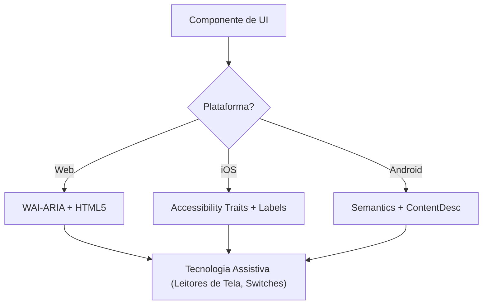

# Acessibilidade (WCAG 2.2)

Esta skill garante que interfaces digitais sejam Perceptíveis, Operáveis, Compreensíveis e Robustas (POUR) para todos os usuários, incluindo quem usa leitores de tela, switch controls ou navegação por teclado. O foco é a implementação técnica dos critérios de sucesso da WCAG 2.2.

## Quando Usar

- Ao definir especificações de componentes de UI para Web, iOS ou Android.
- Ao auditar código existente em busca de barreiras de acessibilidade ou lacunas de conformidade.
- Ao implementar novos padrões da WCAG 2.2, como Target Size (Minimum) e Focus Appearance.
- Ao mapear requisitos de design de alto nível para atributos técnicos (roles ARIA, traits, hints).

## Conceitos Fundamentais

- **Princípios POUR**: a base da WCAG (Perceptível, Operável, Compreensível, Robusto).
- **Mapeamento Semântico**: usar elementos nativos em vez de contêineres genéricos para obter acessibilidade embutida.
- **Árvore de Acessibilidade**: a representação da UI que as tecnologias assistivas de fato "leem".
- **Gerenciamento de Foco**: controlar a ordem e a visibilidade do cursor do teclado/leitor de tela.
- **Labels e Hints**: fornecer contexto via `aria-label`, `accessibilityLabel` e `contentDescription`.

## Como Funciona

### Passo 1: Identificar o Papel do Componente

Determine o propósito funcional (ex.: é um botão, um link ou uma aba?). Use o elemento nativo mais semântico disponível antes de recorrer a roles customizados.

### Passo 2: Definir Atributos Perceptíveis

- Garanta contraste de texto de **4.5:1** (normal) ou **3:1** (grande/UI).
- Adicione alternativas em texto para conteúdo não textual (imagens, ícones).
- Implemente reflow responsivo (até 400% de zoom sem perda de funcionalidade).

### Passo 3: Implementar Controles Operáveis

- Garanta tamanho mínimo de alvo de **24x24 pixels CSS** (WCAG 2.2 SC 2.5.8).
- Verifique se todos os elementos interativos são alcançáveis pelo teclado e têm indicador de foco visível (SC 2.4.11).
- Forneça alternativas de ponteiro único para movimentos de arrastar.

### Passo 4: Garantir Lógica Compreensível

- Use padrões de navegação consistentes.
- Forneça mensagens de erro descritivas e sugestões de correção (SC 3.3.3).
- Implemente "Redundant Entry" (SC 3.3.7) para não pedir o mesmo dado duas vezes.

### Passo 5: Verificar Compatibilidade Robusta

- Use os padrões corretos de `Name, Role, Value`.
- Implemente `aria-live` ou live regions para atualizações dinâmicas de status.

## Diagrama da Arquitetura de Acessibilidade



## Mapeamento entre Plataformas

| Recurso                  | Web (HTML/ARIA)          | iOS (SwiftUI)                        | Android (Compose)                                           |
| :----------------------- | :----------------------- | :----------------------------------- | :---------------------------------------------------------- |
| **Label principal**      | `aria-label` / `<label>` | `.accessibilityLabel()`              | `contentDescription`                                        |
| **Hint secundário**      | `aria-describedby`       | `.accessibilityHint()`               | `Modifier.semantics { stateDescription = ... }`             |
| **Papel de ação**        | `role="button"`          | `.accessibilityAddTraits(.isButton)` | `Modifier.semantics { role = Role.Button }`                 |
| **Atualizações ao vivo** | `aria-live="polite"`     | `.accessibilityLiveRegion(.polite)`  | `Modifier.semantics { liveRegion = LiveRegionMode.Polite }` |

## Exemplos

### Web: Busca Acessível

```html
<form role="search">
  <label for="search-input" class="sr-only">Buscar produtos</label>
  <input type="search" id="search-input" placeholder="Buscar..." />
  <button type="submit" aria-label="Enviar busca">
    <svg aria-hidden="true">...</svg>
  </button>
</form>
```

### iOS: Botão de Ação Acessível

```swift
Button(action: deleteItem) {
    Image(systemName: "trash")
}
.accessibilityLabel("Excluir item")
.accessibilityHint("Remove este item da sua lista permanentemente")
.accessibilityAddTraits(.isButton)
```

### Android: Toggle Acessível

```kotlin
Switch(
    checked = isEnabled,
    onCheckedChange = { onToggle() },
    modifier = Modifier.semantics {
        contentDescription = "Ativar notificações"
    }
)
```

## Antipadrões a Evitar

- **Div-Buttons**: usar `<div>` ou `<span>` para um evento de clique sem adicionar role e suporte a teclado.
- **Significado Apenas por Cor**: indicar erro ou status _somente_ com mudança de cor (ex.: deixar a borda vermelha).
- **Foco de Modal Não Contido**: modais que não prendem o foco, permitindo que usuários de teclado naveguem pelo conteúdo de fundo com o modal aberto. O foco precisa ficar contido _e_ ser liberável pela tecla `Escape` ou por um botão de fechar explícito (WCAG SC 2.1.2).
- **Alt Text Redundante**: usar "Imagem de..." ou "Foto de..." no alt (leitores de tela já anunciam o papel "Imagem").

## Checklist de Boas Práticas

- [ ] Elementos interativos atendem ao tamanho de alvo de **24x24px** (Web) ou **44x44pt** (Nativo).
- [ ] Indicadores de foco são claramente visíveis e de alto contraste.
- [ ] Modais **contêm o foco** enquanto abertos e o liberam corretamente ao fechar (tecla `Escape` ou botão de fechar).
- [ ] Dropdowns e menus devolvem o foco ao elemento que os abriu ao fechar.
- [ ] Formulários fornecem sugestões de erro em texto.
- [ ] Todos os botões só com ícone têm um label de texto descritivo.
- [ ] O conteúdo se reorganiza corretamente quando o texto é ampliado.

## Referências

- [Diretrizes WCAG 2.2](https://www.w3.org/TR/WCAG22/)
- [WAI-ARIA Authoring Practices](https://www.w3.org/TR/wai-aria-practices/)
- [iOS Accessibility Programming Guide](https://developer.apple.com/documentation/accessibility)
- [iOS Human Interface Guidelines - Accessibility](https://developer.apple.com/design/human-interface-guidelines/accessibility)
- [Android Accessibility Developer Guide](https://developer.android.com/guide/topics/ui/accessibility)

## Skills Relacionadas

- `frontend-patterns`
- `frontend-a11y`
